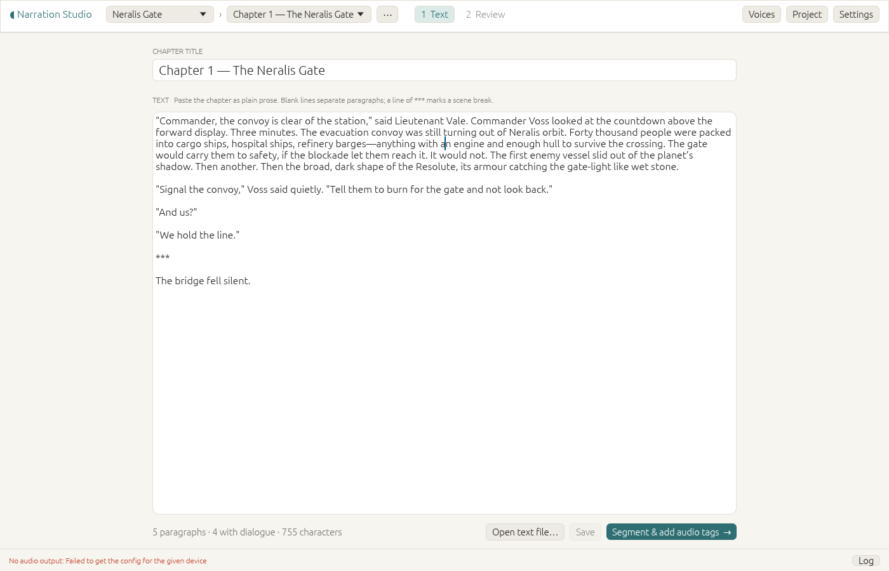
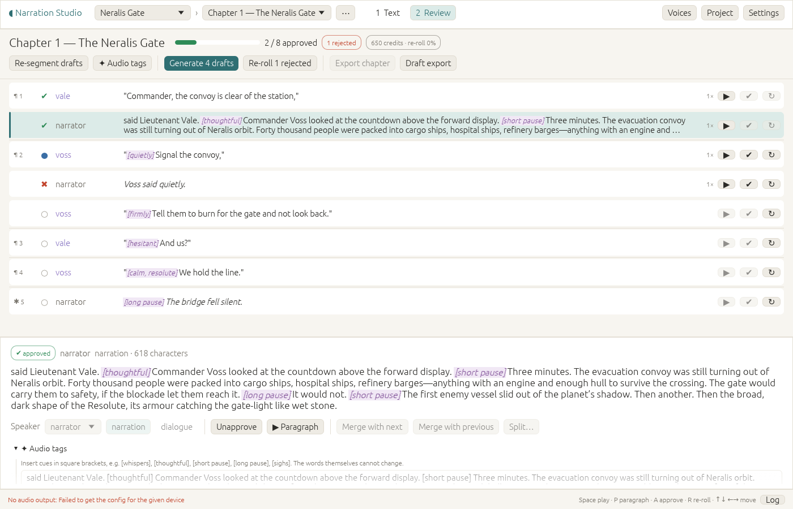

# Narration Studio

A native Linux desktop app that turns long prose into multi-voice audiobook
narration through the ElevenLabs API. Claude attributes speakers and directs
the performance with ElevenLabs audio tags (`[whispers]`, `[thoughtful]`,
`[long pause]`), in narration as well as dialogue. Every segment is reviewed
individually: approve it, or re-roll it with a new seed. Approved chapters are
then assembled and exported as MP3 (ACX spec), FLAC and M4B with chapter
markers.

You work on one chapter at a time, in two tabs:

| 1 Text: paste the chapter as plain prose | 2 Review: speakers, audio tags, takes |
|---|---|
|  |  |

The design and the reasoning behind it are in [docs/design.md](docs/design.md),
including how this first build settles the open decisions.

## Build

Requirements:

- Rust 1.95 or newer (eframe 0.37 requires it)
- Build dependencies: `pkg-config`, `libasound2-dev` (ALSA headers for audio playback)
- Runtime: `ffmpeg` with `libmp3lame` on `PATH` (export only), and a desktop
  session (X11 or Wayland)

```sh
sudo apt install pkg-config libasound2-dev ffmpeg   # Debian/Ubuntu
cargo build --release
./target/release/narration-studio
```

Run the tests with `cargo test`. The export test also encodes with ffmpeg when
it is installed. The pipeline tests drive the workers against local fake
Claude and ElevenLabs servers, so they need no API keys.

## Setup

1. **Settings**: choose how Claude runs (see [Claude](#claude) below) and
   enter your ElevenLabs API key. Keys are stored in
   `~/.config/narration-studio/config.json` (mode 0600). The environment
   variables `ANTHROPIC_API_KEY` and `ELEVENLABS_API_KEY` are used when the
   fields are empty. Appearance is light by default; a dark theme is available.
2. The project menu's **＋ New project…** creates a project. Choose its
   language, which sets the quote styles.
3. **Project**: pick the TTS model (default `eleven_v4`; v4, v4 Turbo and v3
   perform audio tags) and the output format (`pcm_44100` needs the Pro plan or
   higher; `mp3_44100_192` is the fallback). Set the concurrency to your plan's
   limit. Under *Audio tags*, choose the density (light, moderate, rich) and
   add director's notes for the whole book
   ([screenshot](docs/screenshots/project-settings.png)).
4. **Voices**: give every speaker a voice, including the narrator.
   *Choose…* picks one of the voices in your ElevenLabs account; a pasted
   voice id works too (see [Voices](#voices) below).

## Voices

The app offers the voices in your own ElevenLabs account: the ones you
created, cloned or designed, and the Voice Library voices you added to
*My Voices* on elevenlabs.io. It does not browse the public library; add
voices there on the web, then press *⟳ Refresh*
([screenshot](docs/screenshots/voice-picker.png)).

- **Voices dialog.** The list loads when the dialog opens (and stays loaded
  until you refresh it or change the API key). Next to each voice id it shows
  the voice's name, a ▶ preview and *Choose…*. An id that is not in your
  account (an ElevenLabs default voice, say) is looked up by id, and one
  ElevenLabs does not know is marked *⚠ unknown id*; either way the id is
  kept as you typed it.
- **Choose a voice for …** lists your voices with their category, labels and
  description. Search matches the start of any word in the name, labels,
  description or category (`brit narr`; `calm` also finds *DeepCalm*, and
  a pasted voice id finds its voice); the Category, Gender, Age, Accent
  and Language filters offer only the values your voices have. *Used by:
  vale, narrator* marks voices other speakers already have. *Assign* puts the
  voice into the dialog; *Save* there keeps it.
- **Previews** cost no credits. ▶ downloads a voice's preview once (a
  spinner shows meanwhile) and keeps it in `voice-previews/`; a second click
  stops it. Voices without a preview file fall back to a preview in a
  verified language (the project's first), then to the sample you uploaded.
- The API key needs the *Voices: Read* permission (`voices_read`); without
  it the dialog says so, and pasted ids still work. On the Free plan,
  ElevenLabs may refuse Voice Library voices for API use.

## Claude

Claude attributes speakers and adds audio tags. Settings → *Claude* offers two
ways to run it:

- **Claude Code — your Pro/Max subscription.** The app runs your own
  [Claude Code](https://code.claude.com) CLI (`claude -p`), so the calls use
  your plan instead of API billing. Setup:
  1. Install Claude Code (2.1.290 or newer; `claude update` upgrades it).
  2. In a terminal, run `claude auth login` once and choose your Claude
     subscription. Narration Studio never asks for or stores a Claude token.
  3. In Settings, pick *Claude Code*. The section shows the version, whether
     you are signed in and how; *Check again* re-runs the check. If `claude`
     is not on the app's `PATH` or in `~/.local/bin`, set its path there.

  The calls count against your plan's usage limits, which are shared with
  the Claude apps (claude.ai, desktop, mobile). When a limit is reached, the
  run stops with the reset time and leaves unattributed paragraphs as they
  are; *Re-segment drafts* continues later. If your plan does not include
  the project's model (Claude Code says e.g. "Claude Opus is not available
  with the Claude Pro plan"), set Project → Claude → Model to
  `claude-sonnet-5-5`. This backend is meant for your own use on your own
  computer.

  Every run is isolated from your Claude Code setup: no tools, MCP servers,
  hooks, skills or settings files, no session history, and an empty working
  directory. `ANTHROPIC_API_KEY` (and `ANTHROPIC_AUTH_TOKEN`,
  `ANTHROPIC_BASE_URL`) are removed from its environment, because in this
  mode Claude Code would otherwise bill that key instead of your plan;
  Settings says so when one of them is set. If Settings reports
  *billed to the API, not your plan*, Claude Code is signed in with an API
  key: run `claude auth login` and choose your subscription.
- **Anthropic API key — pay per use.** Requests go to the Messages API and are
  billed per token. This is the default.

## Costs

- **ElevenLabs balance.** The top bar shows the credits left and the reset
  date (hover for plan, usage and voice slots; ⟳ refreshes). It is fetched at
  start, after each generation batch, and on refresh. A key without the
  `user_read` permission shows *balance unavailable*; everything else works.
- **Before generating.** The Generate dialog estimates the credits, says where
  the rate comes from, and the share of your remaining balance. It warns when
  the batch exceeds the balance but never stops you. The Review toolbar shows
  *Drafts ≈ N credits*.
- **Where the rate comes from.** Credits per character differ by plan and
  change over time, so the best rate is learned from your own takes: the
  `character-cost` ElevenLabs reports for your last 50 takes of that model.
  Before there are enough takes, the model's list rate from ElevenLabs is
  used, then a built-in table (v4/v3/Multilingual 1.0, Flash/Turbo 0.5 per
  character). A take that comes back without a `character-cost` is recorded
  with this estimate and marked `≈`.
- **Money.** Optionally set your price per 1,000 credits (and a currency) in
  Settings to see money next to credit estimates.
- **Claude.** The Text tab gives a rough token estimate for *Segment & add
  audio tags* before you run it. The Review toolbar shows what the chapter's
  Claude calls used, per pass on hover: tokens and the API list price
  (Opus 5.5: $4 / $20 per million input/output tokens). With Claude Code the
  figure is labelled *API-equivalent (subscription)*: Claude Code reports
  it, but your plan's usage limits apply instead of a bill.

## Workflow

1. **Text tab**: paste the chapter as plain prose, or *Open text file…*.
   Paragraphs are separated by blank lines; a line like `***` or `#` marks a
   scene break. The text stays editable until the chapter has audio. The
   chapter menu at the top switches chapters or starts a new one.
2. **Segment & add audio tags** saves the text, splits paragraphs into
   narration and dialogue, and attributes speakers. Every result is checked
   against the source text, and a paragraph that keeps failing falls back to a
   quote parser with speaker `unknown`. Claude then inserts audio tags into
   narration and dialogue. Tags may only be added: if stripping them doesn't
   give back the exact source words, the suggestion is rejected.
3. **Review tab**: fix attribution and tags while it is free. Change speakers,
   merge or split segments (*Split…* takes `|` markers), and edit a segment's
   tags in the detail panel. **✦ Audio tags** re-runs the tagging for all
   draft segments. Segments whose speaker has no voice show ⚠ and are
   skipped.
4. **Generate N drafts**. A confirmation shows the character count and the
   estimated credits first. Identical inputs reuse cached takes at no cost.
5. Review with the keyboard and approve or re-roll. Earlier takes stay
   available in the take picker.
6. **Export chapter** once every segment is approved, or use **Draft export**
   at any time. **Export book (M4B)** combines all fully approved chapters.

### Keyboard

| Key | Action |
|-----|--------|
| Space | Play / stop the selected segment |
| P | Play the whole paragraph, gapless |
| A | Approve and move to the next segment |
| R | Reject and re-roll with a new seed (generate, if there is no audio yet) |
| ↑ / ↓ | Previous / next segment |
| ← / → | Previous / next paragraph |

## Data

All state lives in one library directory (default
`~/.local/share/narration-studio/`, changeable in Settings):

```
library.sqlite              projects, characters, chapters, paragraphs, segments, takes,
                            Claude usage, credit rates
audio/<take_hash>.wav       every take, 16-bit mono PCM (opens in Audacity)
exports/<project>/          chapter MP3 + FLAC, book M4B
claude-cwd/                 empty working directory for Claude Code runs
voice-previews/             downloaded voice previews (<voice_id>-<url hash>.mp3)
```

Every pipeline stage resumes from this state after a restart.

## Code map

| File | Role |
|------|------|
| `src/segment.rs` | Paragraph splitting, language-aware quote parser, exact-text validator, split/merge helpers |
| `src/tags.rs` | Audio-tag parsing and the check that tags never change the words |
| `src/llm.rs` | Claude attribution and audio-tag direction requests (structured JSON output), API or Claude Code transport |
| `src/claude_code.rs` | Claude Code CLI: lookup, version and sign-in check, isolated `claude -p` runs, result and error parsing |
| `src/costs.rs` | Claude prices, credit-rate learning, token and credit estimates, number formats |
| `src/tts.rs` | ElevenLabs text-to-speech (`tts/account.rs`: balance and model rates; `tts/voices.rs`: your voices, lookups by id, preview downloads) |
| `src/voices.rs` | Voice picker search and filters, "used by", preview sources and the preview cache |
| `src/worker.rs` | Command/event channels, segmentation pass, TTS worker pool, export jobs |
| `src/db.rs` | SQLite schema and queries (`db/costs.rs`: usage and rate tables) |
| `src/audio.rs` | PCM/WAV handling, MP3-fallback decode |
| `src/export.rs` | Streaming assembly with silences; ffmpeg loudnorm and encode |
| `src/hash.rs` | Take hash |
| `src/player.rs` | rodio playback queue |
| `src/app.rs` | egui UI (Text and Review tabs, dialogs; `app/costs.rs`: balance, estimates, Claude settings; `app/voice_picker.rs`: voice picker and previews) |
| `src/theme.rs` | Light (default) and dark themes, semantic colours |
